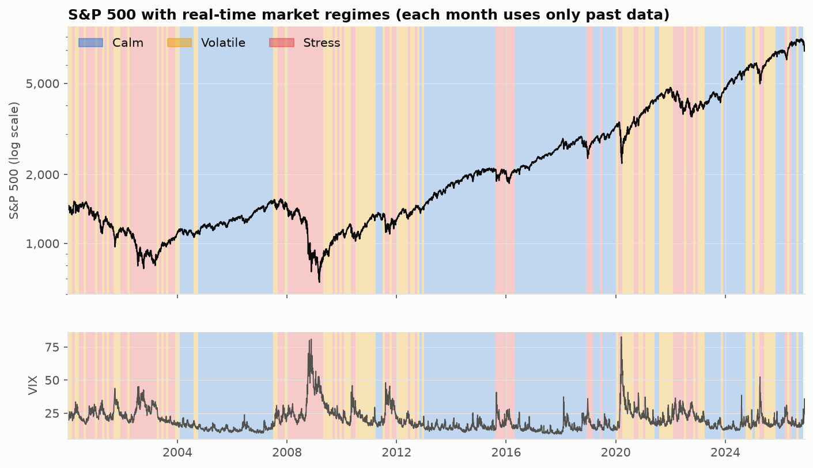
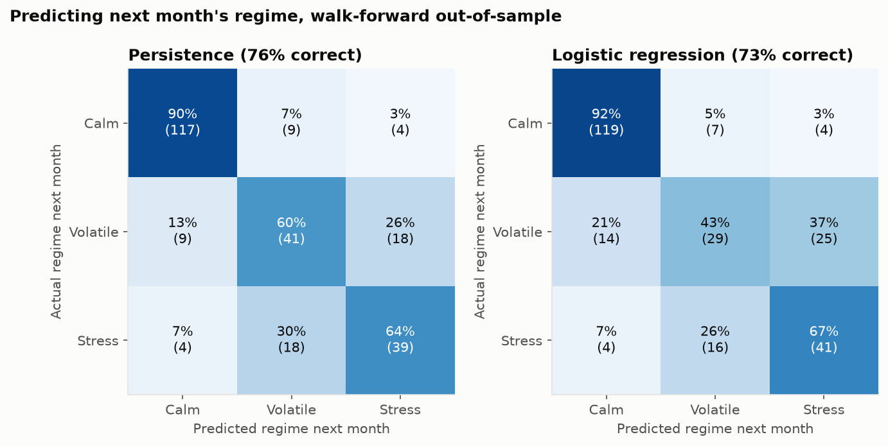
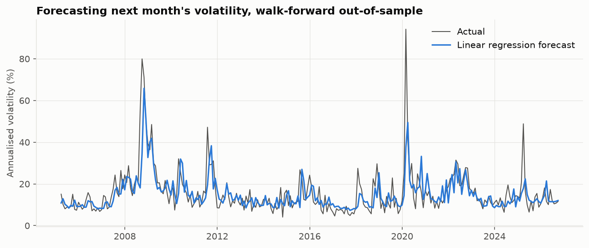
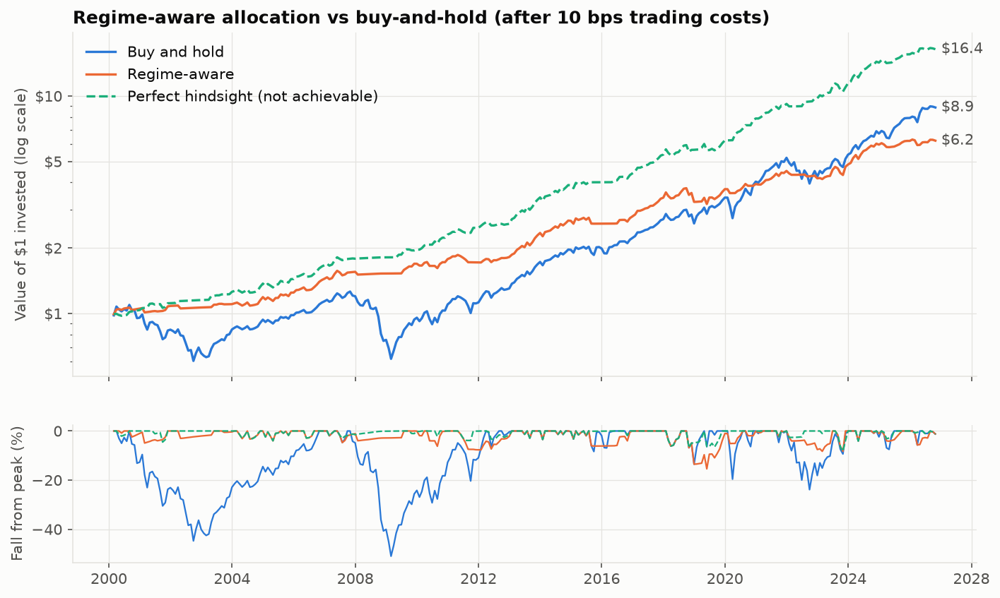

# Market Regime Classifier

**Can we tell, as it happens, whether the stock market is calm, volatile or in stress, and would knowing that have helped an investor?**

A first portfolio project in data science and machine learning by Hussain Rahimi, BSc Economics, University of Bath.



---

## The problem

Markets do not behave the same way all the time. There are long calm stretches where prices drift upwards. There are choppy, volatile periods. And there are stress episodes (2008, March 2020) where prices fall fast. An approach that works well in one of these *regimes* can fail badly in another, and most people only notice the switch after the damage is done.

This project asks three questions:

1. **Detect:** can we label each month as *Calm*, *Volatile* or *Stress* using only the information available at that moment?
2. **Predict:** can we forecast next month's regime and how volatile next month will be?
3. **Act:** would an investor who adjusted their holdings to the regime have done better than one who simply bought and held?

## What I built

- **Data:** daily S&P 500, VIX (the market's "fear gauge"), the S&P 500 total-return index (which includes dividends) and the 3-month US Treasury bill rate, from January 1990 to October 2026. A fixed snapshot is saved in [`data/raw/`](data/raw), so the results can be reproduced exactly.
- **Regime detector:** a *Hidden Markov Model*. Each month it looks at that month's return, volatility and VIX level and works out how likely each regime is *right now*. It is re-trained every month using **only past data**, exactly as you would have to in real life.
- **Forecasting models:** logistic regression and gradient boosting, tested month by month on data they had never seen. They are always compared with two simple rules of thumb: *"next month will be like this month"* and *"the long-run average"*.
- **Strategy test:** a simple rule that holds 100% shares in Calm, 50% in Volatile and 0% in Stress (the rest in Treasury bills), compared with buy-and-hold **after trading costs**.
- **One command runs everything:** `python run_all.py`.

## Key findings

**1. The regimes are real and line up with history.** Without being told any dates, the model flags the dot-com crash, 2008, the 2011 euro crisis, the 2015–16 sell-off, March 2020, the 2022 bear market and the April 2025 tariff shock as Stress.

| Regime | Share of months | Avg. monthly return | Avg. volatility | Avg. VIX |
|---|---|---|---|---|
| Calm | 44% | +0.9% | 10.9% | 14.4 |
| Volatile | 27% | +2.3% | 16.0% | 21.3 |
| Stress | 29% | −1.8% | 24.7% | 26.6 |

Surprisingly, "Volatile" months have the *highest* average return. Many of them are sharp rebounds after a sell-off, which is one reason why stepping out of the market is costly.

**2. Predicting next month's regime: the simplest rule wins.** "Next month will be the same as this month" was right **76%** of the time. Logistic regression managed 73% and gradient boosting 70%. Regimes are sticky, and the machine-learning models did not add anything on top of that. Logistic regression did catch slightly more Stress months (67% versus 64%), at the cost of more false alarms.



**3. Predicting next month's volatility: here the models *do* help.** Linear regression cut the average forecast error from 5.7 to **4.5 volatility points** compared with "same as this month", and it explains about half the variation that the long-run average misses. Volatility is far more predictable than the direction of prices.



**4. The regime strategy did *not* beat buy-and-hold on returns, but it made the ride much smoother.**

| Feb 2000 – Oct 2026, after 0.10% trading costs | Buy and hold | Regime-aware | Perfect hindsight* |
|---|---|---|---|
| Annual return | **8.5%** | 7.1% | 11.0% |
| Annual volatility | 15.1% | **7.6%** | 7.0% |
| Sharpe ratio (return per unit of risk) | 0.49 | **0.68** | 1.25 |
| Worst fall from peak | −51% | **−15%** | −8% |
| $1 grows to | **$8.85** | $6.23 | $16.40 |

\*Perfect hindsight uses *next* month's regime, which is impossible in practice. It shows how much regime knowledge *could* be worth if you could see it early, which is a lot.



**The honest summary:** knowing the regime would have roughly halved risk and avoided the worst of the 2000–02 and 2008 crashes. But because the model only recognises a regime *after* it has started, the strategy also sat out many rebounds and ended up with less money than simply holding the market. The gap between "regime-aware" and "perfect hindsight" is the cost of noticing too late, which is exactly the problem this project set out to study. Higher trading costs make it worse: at 0.50% per trade the annual return falls to 6.3%.

## Limitations

- **One market, one period.** Results are for the US S&P 500 since 2000. Other markets or decades may differ.
- **Sample size is small.** There are about 260 months of out-of-sample predictions and only a handful of true crises, so differences of a few percentage points may be luck.
- **Choices were mine.** The 3 regimes, the 100/50/0 allocation and the 10-year training warm-up are reasonable, but different choices would give different numbers. I did not tune them to make the results look better.
- **Simplified trading.** Trades are assumed to happen at the month-end closing price, with no taxes and with cash earning the T-bill rate.
- **Regime labels are model outputs, not facts.** "Stress" means "the highest-volatility state this model found", not an official crisis date.
- **Not investment advice.** This is a learning project.

## How to run it

You need Python 3.10 or newer (tested with 3.14).

```bash
git clone https://github.com/rahim-i/market-regime-classifier.git
cd market-regime-classifier
python3 -m venv .venv
source .venv/bin/activate          # on Windows: .venv\Scripts\activate
pip install -r requirements.txt
python run_all.py                  # about 1–2 minutes
python -m pytest                   # run the tests
```

`run_all.py` uses the saved data snapshot, so you get the same numbers as above. To download fresh data instead, run `python run_all.py --refresh` (the numbers will then change slightly).

Outputs: charts go to [`figures/`](figures) and tables to [`results/`](results) (see [`results/results.md`](results/results.md)).

---

## Technical details

### Project structure

```
├── run_all.py            # runs the whole pipeline
├── src/
│   ├── config.py         # every setting and assumption in one place
│   ├── data.py           # download + snapshot (data/raw/market_data.csv)
│   ├── features.py       # daily prices -> monthly features
│   ├── regimes.py        # expanding-window Gaussian HMM, filtered probabilities
│   ├── prediction.py     # walk-forward models and baselines
│   ├── backtest.py       # regime-aware allocation vs buy-and-hold
│   └── plots.py          # charts
├── tests/test_pipeline.py
├── data/raw/             # raw data snapshot
├── figures/              # charts
└── results/              # CSV tables and results.md
```

### Features (monthly, from daily data)

| Feature | Definition |
|---|---|
| `ret` | log return of the S&P 500 over the month |
| `rvol` | realised volatility: std. dev. of daily log returns × √252 |
| `log_rvol`, `log_vix` | logs of realised volatility and month-end VIX |
| `tr_ret` | simple total return (with dividends), used only in the backtest |
| `rf` | T-bill yield at the *previous* month-end ÷ 12, used as the cash return |

The current, incomplete month is dropped.

### Regime detection

- `hmmlearn.GaussianHMM`, 3 states, full covariance, on `[ret, log_rvol, log_vix]`.
- **Expanding window:** at every month-end *t* from month 120 onwards (Jan 2000), a new HMM is fitted on months 1…*t* only. Features are standardised with the mean and standard deviation of months 1…*t*.
- Five random initialisations per fit; the one with the highest log-likelihood is kept.
- **Filtered probabilities:** `predict_proba` on months 1…*t* runs the forward–backward algorithm. For the *last* observation the backward pass contributes nothing, so its posterior equals the filtered probability P(state_t | data_1…t).
- **Label switching:** HMM state numbers are arbitrary, so states are re-ordered in every fit by their mean `log_rvol` (lowest = Calm, highest = Stress).
- The regime at *t* is the state with the highest filtered probability.

### Prediction

- Inputs at month *t*: filtered regime probabilities, `ret`, 3-month return, `log_rvol`, `log_vix`, `log_vix − log_rvol` (a volatility risk premium proxy) and the 1-month change in `log_vix`.
- Targets: the regime at *t*+1 (3-class), and `log_rvol` at *t*+1.
- Models: `LogisticRegression` and `GradientBoostingClassifier` for the regime; `LinearRegression` and `GradientBoostingRegressor` for volatility (logistic regression is a classifier, so linear regression is its natural counterpart for a continuous target).
- **Walk-forward:** expanding window, re-trained every month, with 60 months of regime history before the first forecast. At row *t* the model is trained on rows 0…*t*−1, whose targets (months 1…*t*) are all known at time *t*.
- Baselines: *persistence* (next = current) and *historical average* (most frequent regime so far; mean log-volatility so far).
- Metrics: accuracy, balanced accuracy, Stress recall; volatility MAE in annualised volatility points, and out-of-sample R² relative to the historical-average forecast.

| Regime model | Accuracy | Balanced accuracy | Stress recall |
|---|---|---|---|
| Persistence | **76.1%** | **71.4%** | 63.9% |
| Historical average | 42.5% | 34.3% | 34.4% |
| Logistic regression | 73.0% | 67.1% | **67.2%** |
| Gradient boosting | 69.5% | 63.1% | 65.6% |

| Volatility model | MAE (vol points) | Out-of-sample R² vs historical average |
|---|---|---|
| Persistence | 5.69 | 27.1% |
| Historical average | 6.70 | 0.0% |
| Linear regression | **4.48** | **52.6%** |
| Gradient boosting | 4.89 | 48.2% |

### Backtest

- The weight is decided at month-end *t* from the filtered regime at *t* and applied to month *t*+1's total return; the remainder earns the T-bill return.
- Cost = |change in weight| × 10 bps, including the initial purchase. Weight drift within the month is ignored.
- All strategies are compared over the same months (Feb 2000 – Oct 2026).

| Cost per trade | Annual return | Sharpe | Max drawdown |
|---|---|---|---|
| 0 bps | 7.27% | 0.71 | −15.2% |
| 10 bps | 7.08% | 0.68 | −15.4% |
| 25 bps | 6.79% | 0.65 | −15.7% |
| 50 bps | 6.31% | 0.59 | −16.1% |

### How look-ahead bias is prevented and tested

| Where it could leak | Safeguard | Test |
|---|---|---|
| Regime detection | Fresh HMM per month on data up to *t*; filtered (not smoothed) probabilities; standardisation from past data only | `test_regimes_have_no_lookahead`: regimes computed on a truncated dataset must exactly match those computed on the full dataset |
| Monthly features | Built only from days within or before each month | `test_monthly_features_have_no_lookahead`: shocking later prices must not change earlier features |
| Model training | Walk-forward training on rows 0…*t*−1 | `test_walk_forward_trains_only_on_the_past` |
| Backtest | Weights lagged one month; cash rate known at the start of the month | `test_backtest_basics` |

### Data sources

Yahoo Finance via `yfinance`: `^GSPC`, `^SP500TR`, `^VIX`, `^IRX`. See [`data/raw/SNAPSHOT_INFO.txt`](data/raw/SNAPSHOT_INFO.txt) for the download date.

## Licence

MIT. See [LICENSE](LICENSE).
